# gitee添加钉钉机器人通知

### 1、钉钉客户端设置

#### 步骤:

下载钉钉客户端 —> 群组 -> 右上角设置 -> 点击群管理(机器人) -> 添加机器人 ->选择自定义的机器人 -> 添加 -> 输入机器人名字和自定义关键词(gitee) -> 点击完成 -> 复制链接

#### 图例：

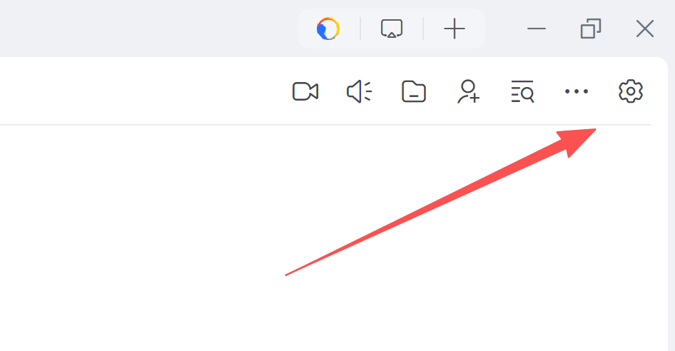
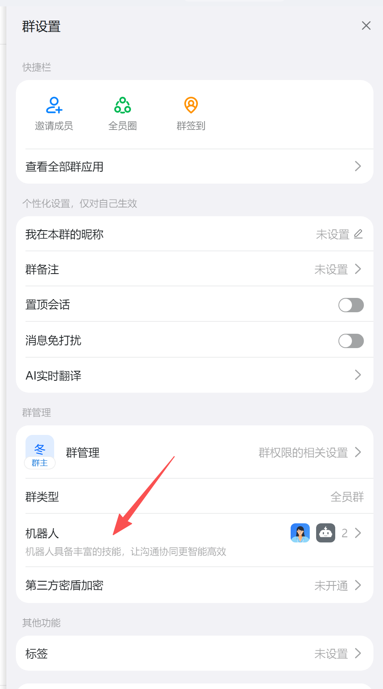
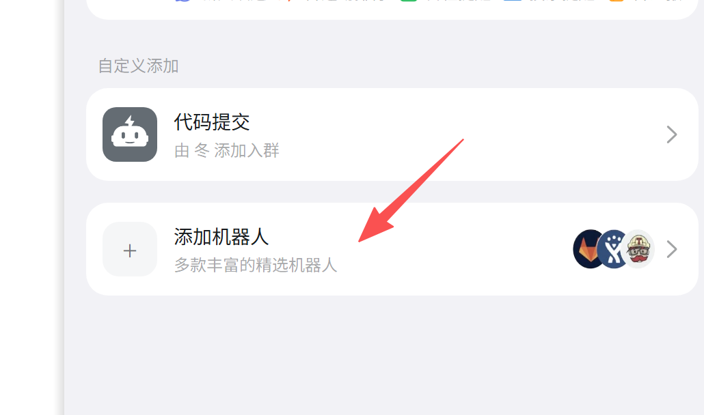
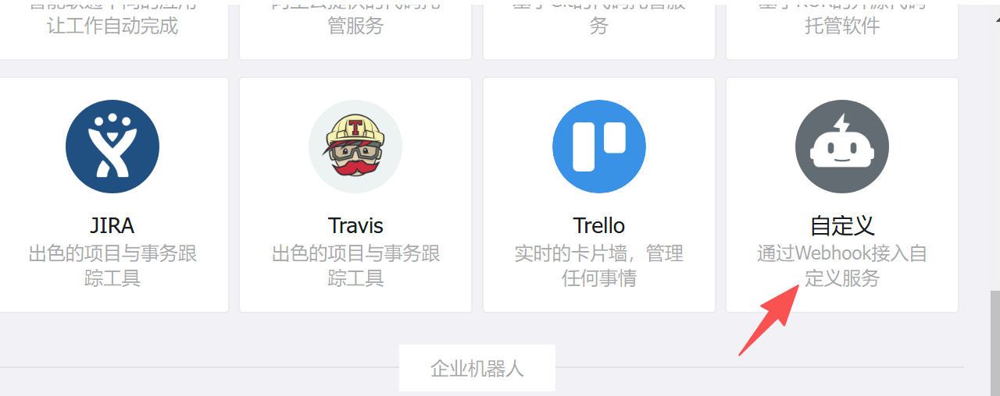
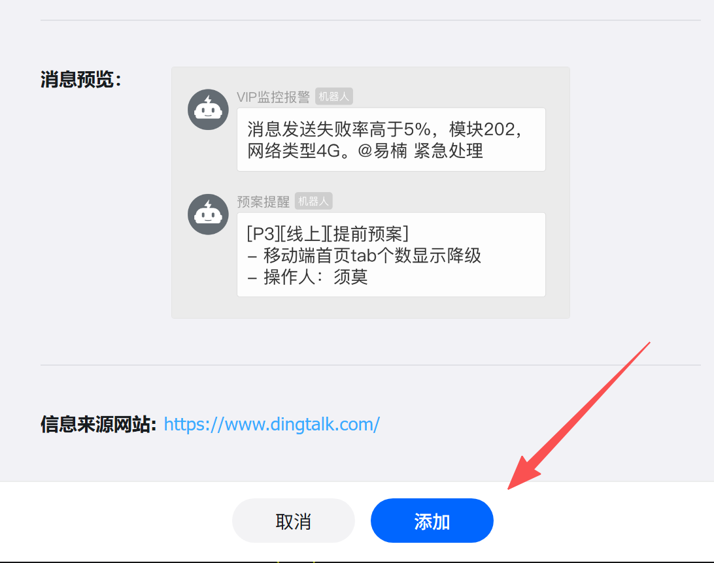
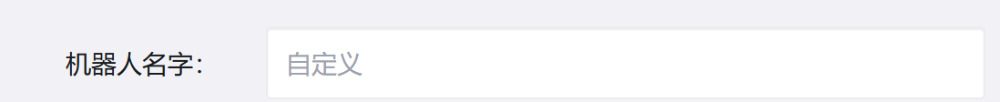
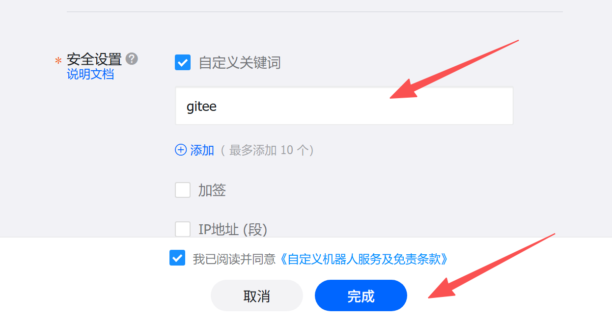

### 2、gitee设置

#### 步骤:
1、进入一个代码仓库->管理->webHooks -> 添加webHook ->输入链接、别名、密码->选择事件->点击添加
 
2、点击左侧导航栏保护分支设置->将master或者main设置为默认分支（一般不用改）->新建规则->设置分支/通配符(一般master)->规则百名单(个人一般不需要，团队需要)->可推送代码成员(一般选择仓库管理员)->可合并Pull Request成员(一般选择仓库管理员)->要求门禁状态成功才能合并(个人标准模式，团队才需要评审模式)->保存

#### 图例：
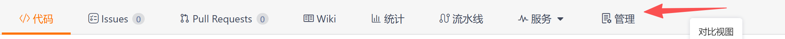
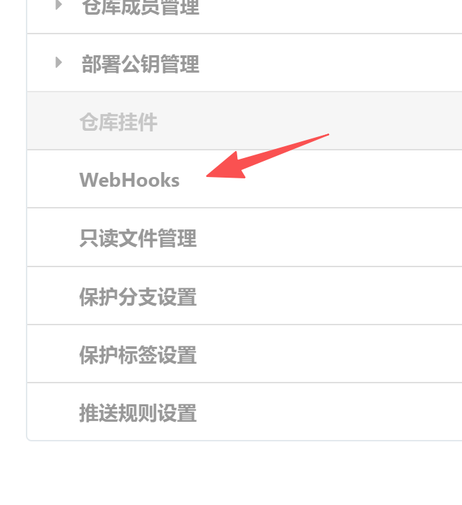
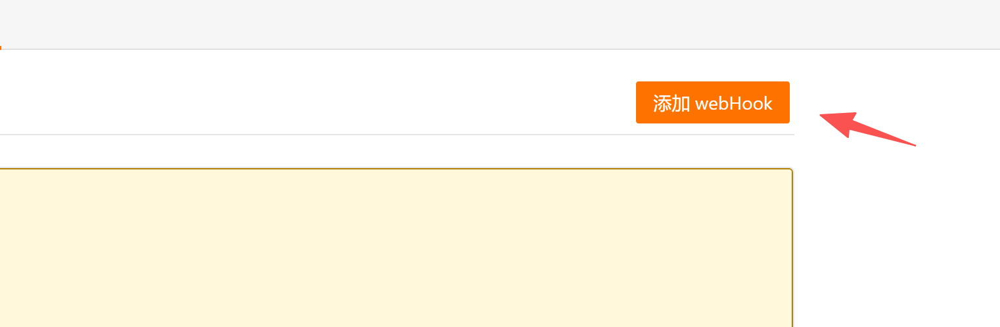
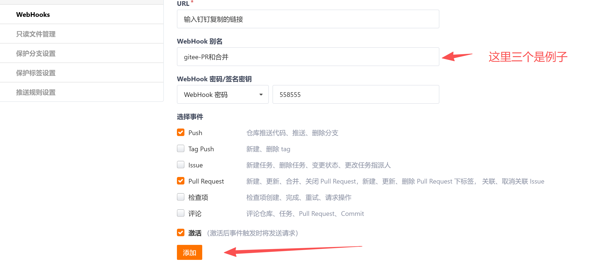
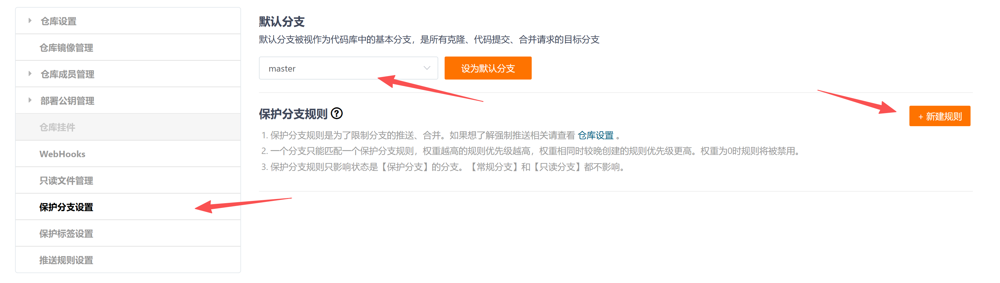
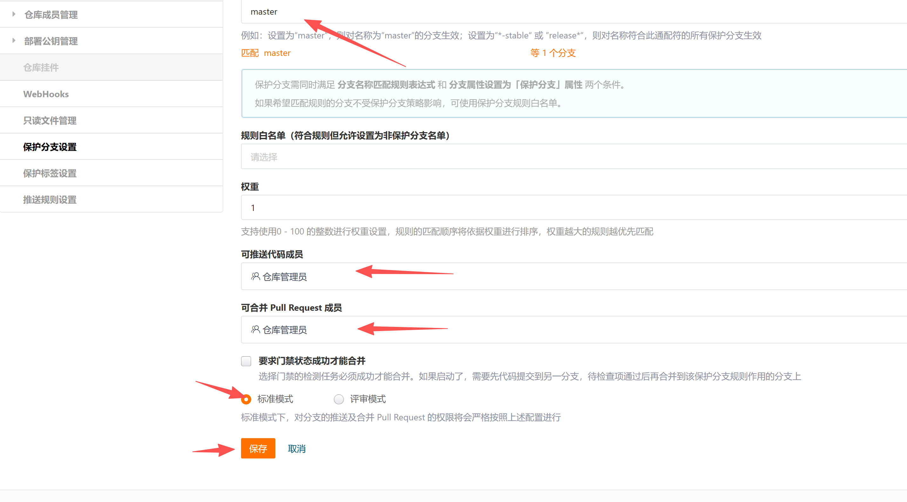

