# 使用npm搭建并部署vitepress网站

[vitepress官网][https://vitepress.dev/zh/guide/getting-started]

### 一、开发工具安装和环境配置

安装vscode或者HBuilder

配置node环境

22.16.0

安装npm

10.9.2

### 二、安装vitepress

新建文件夹，打开cmd窗口

`
npm add -D vitepress@next
`

### 三、初始化vitepress

`
npx vitepress init
`

需要回答下面几个简单问题：

#### 我当前项目的选择

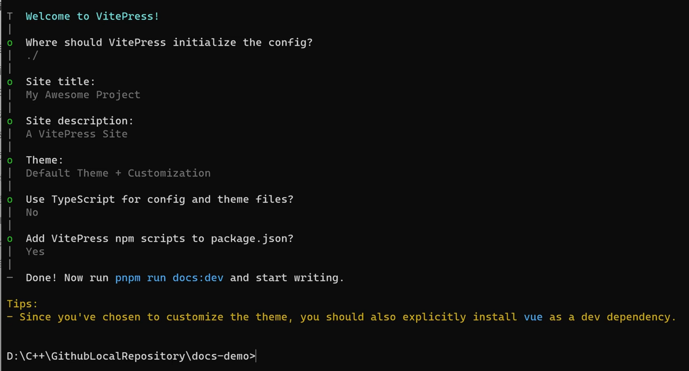

#### 官方文档的选择

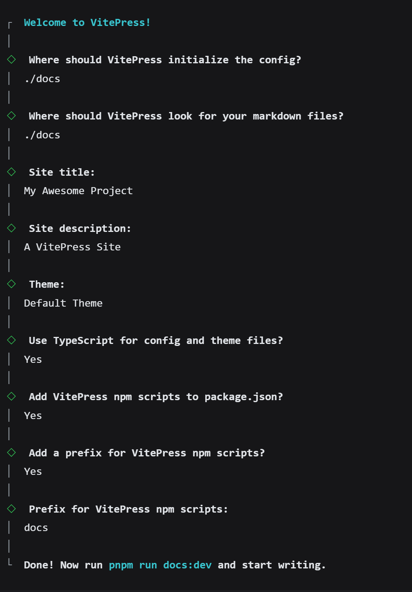

### 四、使用VSCode打开项目项目
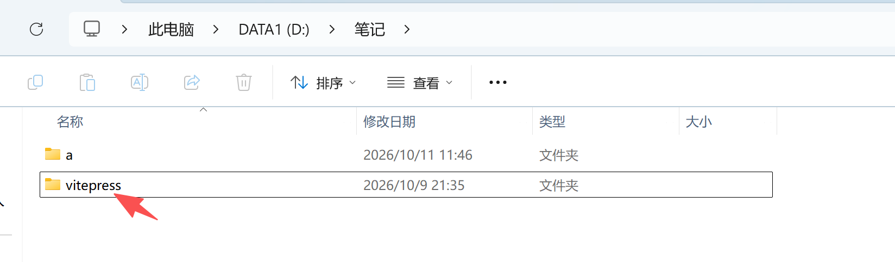
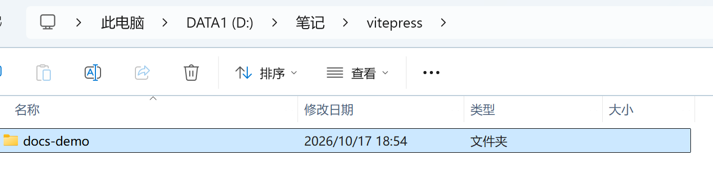
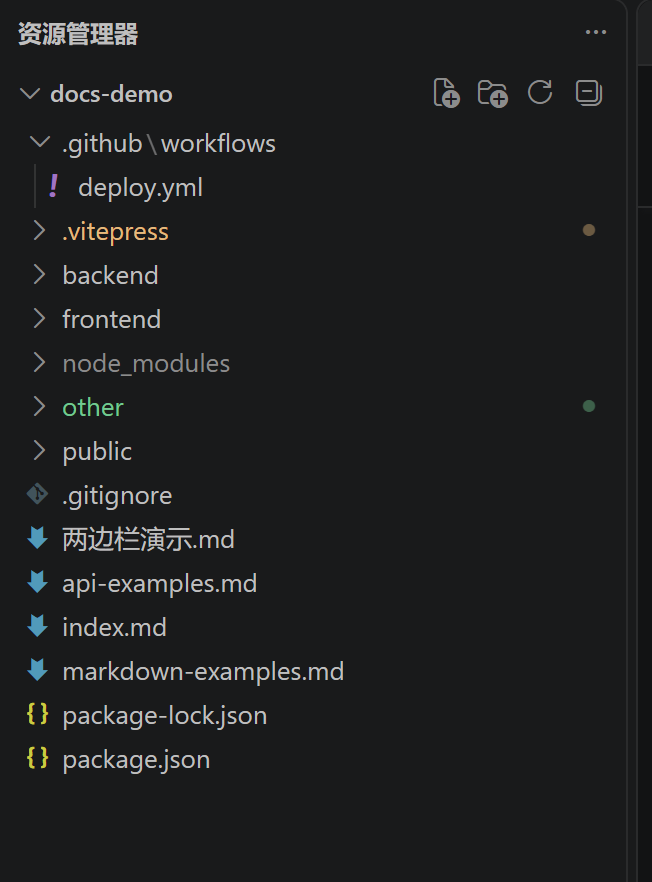

#### 执行项目

`
npm run dev
`

### 五、首页修改

#### 底部配置
.vitepress中打开config.mjs
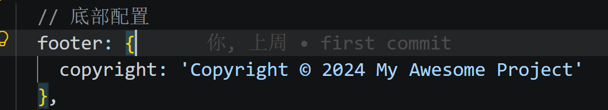

#### 中间区域设置
imdex.md文件修改位置和视图对应
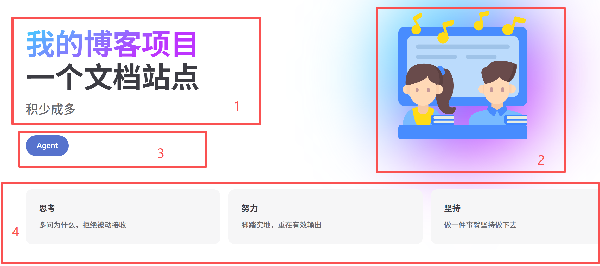
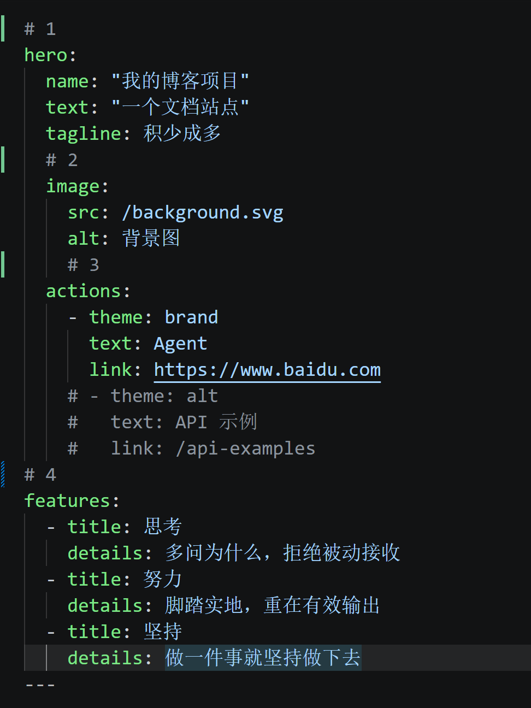

#### 右上导航设置

##### 根目录新建文件夹，新建.md文件

<strong style="color:red;">注意：新文件夹中必须包含一个index.md</strong>

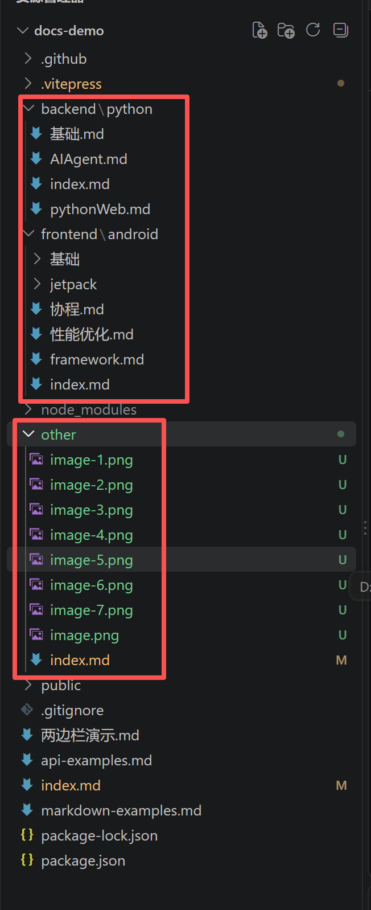

##### 首页设置单级显示
```
{ text: 'Python', link: '/backend/python/' },
{ text: 'Android', link: '/frontend/android/' },
```
##### 首页设置多级显示
```
    { text: 'Python', items: [
        { text: 'Python基础', link: '/backend/python/基础' },
        { text: 'PythonWeb', link: '/backend/python/pythonWeb' },
        { text: 'AI大模型', link: '/backend/python/AIAgent' },
        { text: '爬虫', link: '/backend/python/' },
    ] },
```
<strong style="color:red;">
注意：<br/>
1、文件夹中只有一个index.md文件的link路径，如/backend/python/
<br/>
2、有多个md文件要link选取到对应的文件，如/backend/python/pythonWeb
</strong>

#### 首页logo和标题修改
根目录新建public文件加入图片
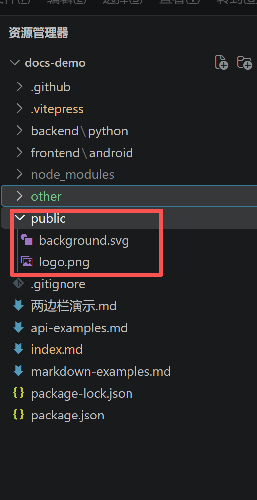

themeConfig中添加
```
logo: '/logo.png',
```
export default defineConfig中添加
```
base: '/docs-demo/',
head: [["link", { rel: "icon", href: "/logo.png" }]], //美化地址栏icon
title: "我的博客",  // 博客标题
description: "SEO优化使用",
```
#### 添加社交链接
```
socialLinks: [
  { icon: 'github', link: 'https://github.com/lixiaodong1222' },
  {
    icon: {
      svg: `<svg t="1791595097159" class="icon" viewBox="0 0 1024 1024" version="1.1" xmlns="http://www.w3.org/2000/svg" p-id="20454" width="32" height="32"><path d="M512 1024C229.2224 1024 0 794.7776 0 512S229.2224 0 512 0s512 229.2224 512 512-229.2224 512-512 512z m259.1488-568.8832H480.4096a25.2928 25.2928 0 0 0-25.2928 25.2928l-0.0256 63.2064c0 13.952 11.3152 25.2928 25.2672 25.2928h177.024c13.9776 0 25.2928 11.3152 25.2928 25.2672v12.6464a75.8528 75.8528 0 0 1-75.8528 75.8528H366.592a25.2928 25.2928 0 0 1-25.2672-25.2928v-240.1792a75.8528 75.8528 0 0 1 75.8272-75.8528h353.9456a25.2928 25.2928 0 0 0 25.2672-25.2928l0.0768-63.2064a25.2928 25.2928 0 0 0-25.2672-25.2928H417.152a189.6192 189.6192 0 0 0-189.6192 189.6448v353.9456c0 13.9776 11.3152 25.2928 25.2928 25.2928h372.9408a170.6496 170.6496 0 0 0 170.6496-170.6496v-145.408a25.2928 25.2928 0 0 0-25.2928-25.2672z" fill="#C71D23" p-id="20455"></path></svg>`
    },
    link: 'https://gitee.com/lixiaodong93'
  }
],
```
### 六、md文件格式设置

#### utils中创建auto_sidebar.mjs文件

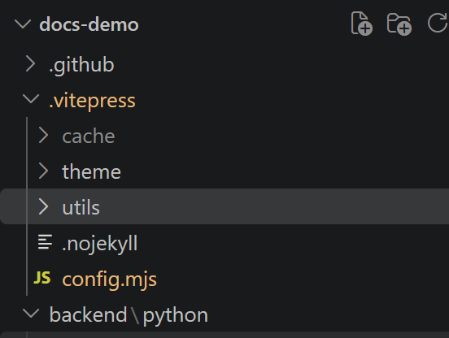

```
import path from "node:path";
import fs from "node:fs";
console.log("==== auto_sidebar 模块加载成功 ====");
// 文件根目录
const DIR_PATH = path.resolve();
// 白名单,过滤不是文章的文件和文件夹
const WHITE_LIST = [
  "index.md",
  ".vitepress",
  "node_modules",
  ".idea",
  "assets",
];
// 判断是否是文件夹
const isDirectory = (p) => fs.lstatSync(p).isDirectory();
// 取差值
const intersections = (arr1, arr2) =>
  Array.from(new Set(arr1.filter((item) => !new Set(arr2).has(item))));

// 递归生成侧边栏
function getList(params, path1, pathname) {
  const res = [];
  for (const file of params) {
    const fullPath = path.join(path1, file);
    const isDir = isDirectory(fullPath);

    if (isDir) {
      // 文件夹递归
      const subFiles = fs.readdirSync(fullPath);
      res.push({
        text: file,
        collapsible: true,
        items: getList(subFiles, fullPath, `${pathname}/${file}`),
      });
    } else {
      const filename = path.basename(file);
      const suffix = path.extname(filename);
      if (suffix !== ".md") continue;

      // ✅ 提前去除 .md
      const title = filename.replace(/\.md$/, "");
      let link;
      if (filename === "index.md") {
        // index.md 路由末尾带斜杠
        link = `${pathname}/`;
      } else {
        // 普通md，不带后缀
        link = `${pathname}/${title}`;
      }
      res.push({
        text: title,
        link: link,
      });
    }
  }
  return res;
}

export const set_sidebar = (pathname) => {
  const dirPath = path.join(DIR_PATH, pathname);
  console.log("【set_sidebar】读取目录：", dirPath);
  try {
    const files = fs.readdirSync(dirPath);
    console.log("【set_sidebar】目录下文件列表：", files);
    const items = intersections(files, WHITE_LIST);
    console.log("【set_sidebar】过滤后文件：", items);
    const sidebarData = getList(items, dirPath, pathname);
    console.log("【set_sidebar】生成侧边栏结果：", JSON.stringify(sidebarData,null,2));
    return sidebarData;
  } catch(err) {
    console.error("【set_sidebar 读取文件夹异常】", err);
    return [];
  }
};
```

在config.mjs中引入
```
import { set_sidebar } from "../.vitepress/utils/auto_sidebar.mjs"; // 改成自己的路径
```
#### 三栏设置
themeConfig中添加
```
 sidebar: { 
      "/frontend/android/": set_sidebar("frontend/android"),
      "/backend/python/": set_sidebar("backend/python"),
    },
```
#### 两栏设置
themeConfig中添加下面两个
```
 outline: { // 右侧大纲级别
      level: [2, 6],
      label: "目录",
      expand: true,
    },
```

```
sidebar: false, // 关闭默认侧边栏
aside:"left", // 右侧边栏在左侧显示
```

##### 三栏设置为两栏左边显示太宽，需要添加自定义的css样式
```
/**
 * Customize default theme styling by overriding CSS variables:
 * https://github.com/vuejs/vitepress/blob/main/src/client/theme-default/styles/vars.css
 */

/**
 * Colors
 *
 * Each colors have exact same color scale system with 3 levels of solid
 * colors with different brightness, and 1 soft color.
 *
 * - `XXX-1`: The most solid color used mainly for colored text. It must
 *   satisfy the contrast ratio against when used on top of `XXX-soft`.
 *
 * - `XXX-2`: The color used mainly for hover state of the button.
 *
 * - `XXX-3`: The color for solid background, such as bg color of the button.
 *   It must satisfy the contrast ratio with pure white (#ffffff) text on
 *   top of it.
 *
 * - `XXX-soft`: The color used for subtle background such as custom container
 *   or badges. It must satisfy the contrast ratio when putting `XXX-1` colors
 *   on top of it.
 *
 *   The soft color must be semi transparent alpha channel. This is crucial
 *   because it allows adding multiple "soft" colors on top of each other
 *   to create an accent, such as when having inline code block inside
 *   custom containers.
 *
 * - `default`: The color used purely for subtle indication without any
 *   special meanings attached to it such as bg color for menu hover state.
 *
 * - `brand`: Used for primary brand colors, such as link text, button with
 *   brand theme, etc.
 *
 * - `tip`: Used to indicate useful information. The default theme uses the
 *   brand color for this by default.
 *
 * - `warning`: Used to indicate warning to the users. Used in custom
 *   container, badges, etc.
 *
 * - `danger`: Used to show error, or dangerous message to the users. Used
 *   in custom container, badges, etc.
 * -------------------------------------------------------------------------- */

:root {
  --vp-c-default-1: var(--vp-c-gray-1);
  --vp-c-default-2: var(--vp-c-gray-2);
  --vp-c-default-3: var(--vp-c-gray-3);
  --vp-c-default-soft: var(--vp-c-gray-soft);

  --vp-c-brand-1: var(--vp-c-indigo-1);
  --vp-c-brand-2: var(--vp-c-indigo-2);
  --vp-c-brand-3: var(--vp-c-indigo-3);
  --vp-c-brand-soft: var(--vp-c-indigo-soft);

  --vp-c-tip-1: var(--vp-c-brand-1);
  --vp-c-tip-2: var(--vp-c-brand-2);
  --vp-c-tip-3: var(--vp-c-brand-3);
  --vp-c-tip-soft: var(--vp-c-brand-soft);

  --vp-c-warning-1: var(--vp-c-yellow-1);
  --vp-c-warning-2: var(--vp-c-yellow-2);
  --vp-c-warning-3: var(--vp-c-yellow-3);
  --vp-c-warning-soft: var(--vp-c-yellow-soft);

  --vp-c-danger-1: var(--vp-c-red-1);
  --vp-c-danger-2: var(--vp-c-red-2);
  --vp-c-danger-3: var(--vp-c-red-3);
  --vp-c-danger-soft: var(--vp-c-red-soft);
}

/**
 * Component: Button
 * -------------------------------------------------------------------------- */

:root {
  --vp-button-brand-border: transparent;
  --vp-button-brand-text: var(--vp-c-white);
  --vp-button-brand-bg: var(--vp-c-brand-3);
  --vp-button-brand-hover-border: transparent;
  --vp-button-brand-hover-text: var(--vp-c-white);
  --vp-button-brand-hover-bg: var(--vp-c-brand-2);
  --vp-button-brand-active-border: transparent;
  --vp-button-brand-active-text: var(--vp-c-white);
  --vp-button-brand-active-bg: var(--vp-c-brand-1);
}

/**
 * Component: Home
 * -------------------------------------------------------------------------- */

:root {
  --vp-home-hero-name-color: transparent;
  --vp-home-hero-name-background: -webkit-linear-gradient(
    120deg,
    #bd34fe 30%,
    #41d1ff
  );

  --vp-home-hero-image-background-image: linear-gradient(
    -45deg,
    #bd34fe 50%,
    #47caff 50%
  );
  --vp-home-hero-image-filter: blur(44px);
}

@media (min-width: 40rem) {
  :root {
    --vp-home-hero-image-filter: blur(56px);
  }
}

@media (min-width: 60rem) {
  :root {
    --vp-home-hero-image-filter: blur(68px);
  }
}

/**
 * Component: Custom Block
 * -------------------------------------------------------------------------- */

:root {
  --vp-custom-block-tip-border: transparent;
  --vp-custom-block-tip-text: var(--vp-c-text-1);
  --vp-custom-block-tip-bg: var(--vp-c-brand-soft);
  --vp-custom-block-tip-code-bg: var(--vp-c-brand-soft);
}


/* 自定义侧边栏在最左边，右边撑满宽度 */
.VPDoc .container {
  margin: 0 !important;
}
@media (min-width: 960px) {
  .VPDoc:not(.has-sidebar) .content {
    max-width: 1552px !important;
  }
}
.VPDoc.has-aside .content-container {
  max-width: 1488px !important;
}
@media (min-width: 960px) {
  .VPDoc:not(.has-sidebar) .container {
    display: flex;
    justify-content: center;
    max-width: 1562px !important;
  }
}
.aside-container {
  position: fixed;
  top: 0;
  padding-top: calc(
    var(--vp-nav-height) + var(--vp-layout-top-height, 0px) +
      var(--vp-doc-top-height, 0px) + 10px
  ) !important;
  width: 224px;
  height: 100vh;
  overflow-x: hidden;
  overflow-y: auto;
  scrollbar-width: none;
}

/* 自定义h2的间距 */
.vp-doc h2 {
  margin: 0px 0 16px;
  padding-top: 24px;
  border: none;
}
```

### 七、搜索框设置

themeConfig中添加
```
 // 设置搜索框的样式
    search: {
      provider: "local",
      options: {
        translations: {
          button: {
            buttonText: "搜索文档",
            buttonAriaLabel: "搜索文档",
          },
          modal: {
            noResultsText: "无法找到相关结果",
            resetButtonTitle: "清除查询条件",
            footer: {
              selectText: "选择",
              navigateText: "切换",
            },
          },
        },
      },
    },
```
### 八、github pages部署
基于git 支持CI/CD

#### 1、创建仓库

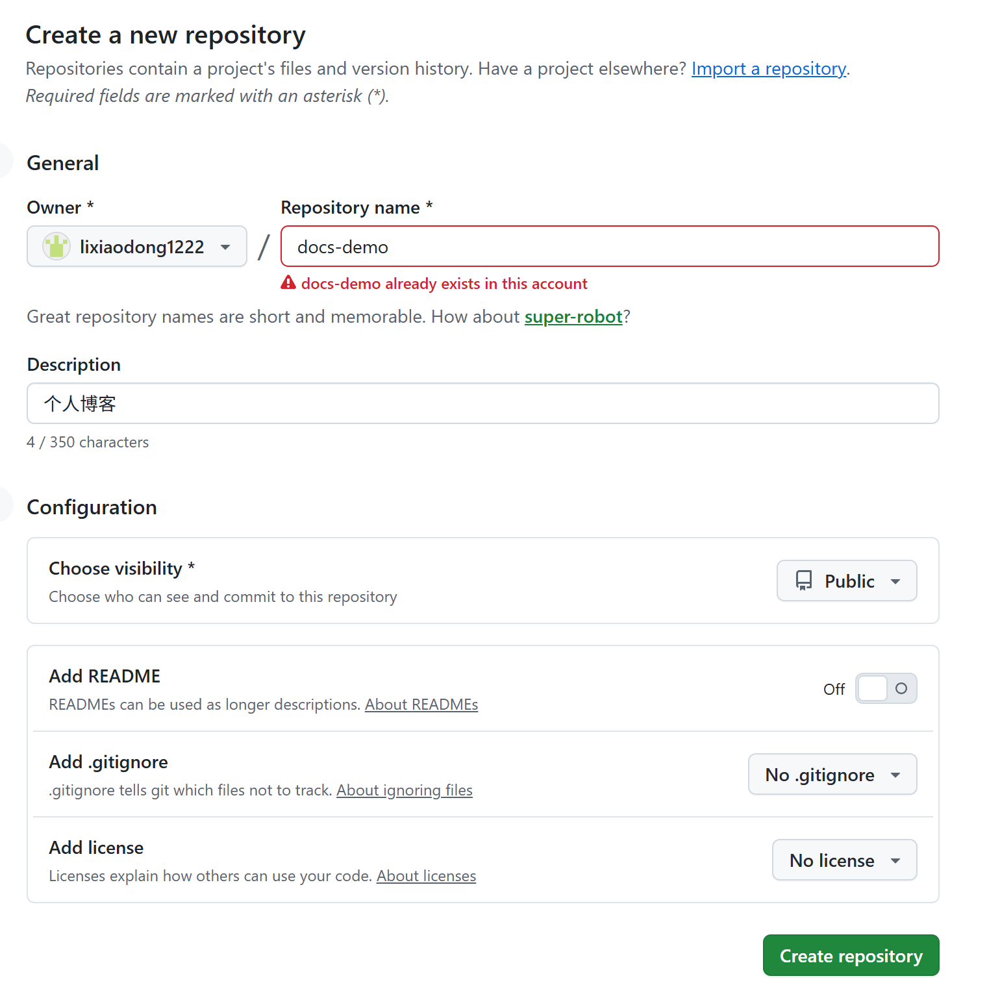

#### 2、添加忽略文件
根目录添加.gitignore文件，添加忽略设置
```
node_modules/
.DS_Store
dist/
dist-ssr/
cache/
.cache/
.temp/
*.local
Thumbs.db
desktop.ini
```

#### 3、仓库同步

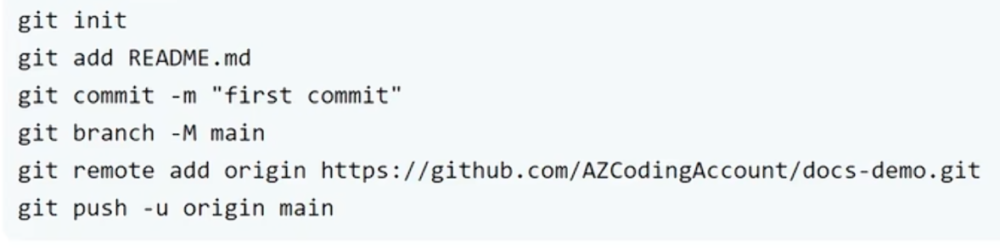

#### 4、设置
##### 4.1、选择github Actions
github ->settings ->pages ->Build and deployment
1、Source选择 Deploy from a branch
2、Branch：选 gh-pages，目录选 / (root)
点 Save 保存

##### 4.2、设置工作流
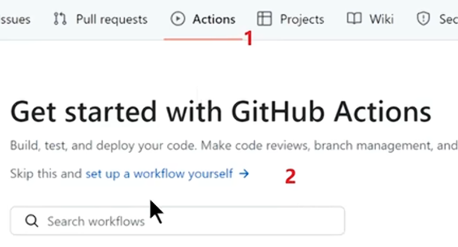
重命名并设置deploy脚本
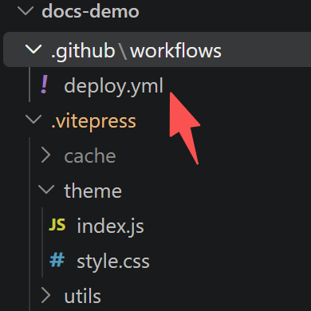
```
name: Deploy
on:
  push:
    branches:
      - master
permissions:
  contents: write # 允许写入仓库，创建gh-pages分支
jobs:
  deploy:
    runs-on: ubuntu-latest
    steps:
      - uses: actions/checkout@v4
        with:
          fetch-depth: 0
      - uses: actions/setup-node@v4
        with:
          node-version: 20
          cache: npm
      - run: npm install
      - name: Build
        run: npm run build
      - name: Deploy
        uses: peaceiris/actions-gh-pages@v3
        with:
          github_token: ${{ secrets.GITHUB_TOKEN }}
          publish_dir: .vitepress/dist
          publish_branch: gh-pages
          full_commit_message: ${{ github.event.head_commit.message }}
```

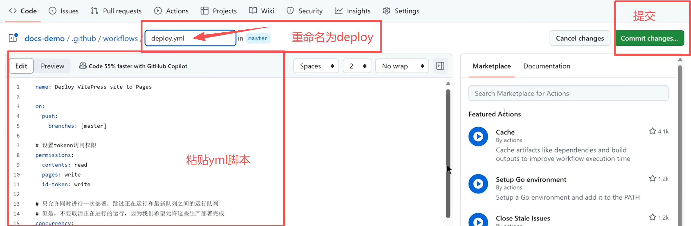
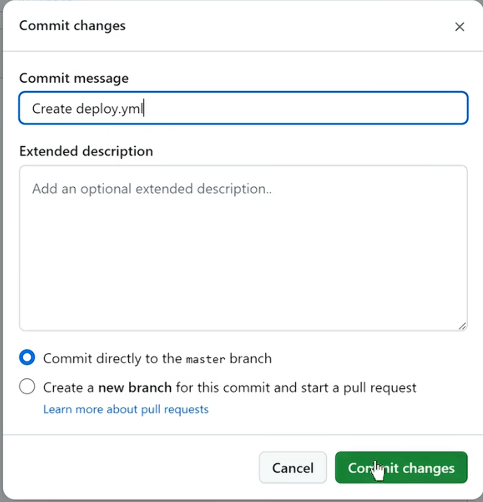
##### 点击确定等待15秒，Actions中可以查看是否成功，不成功需要修改yml再次提交
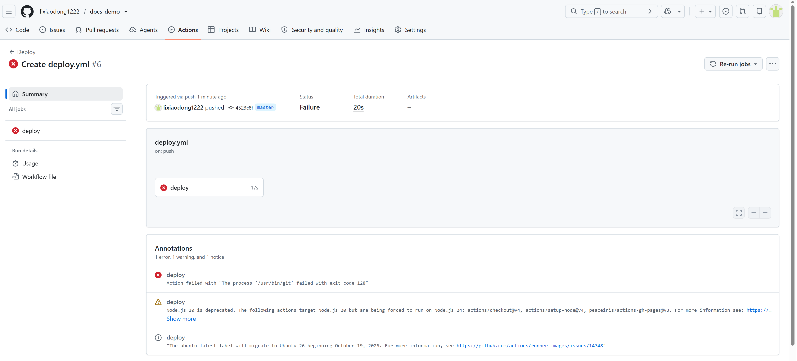
##### 成功后显示
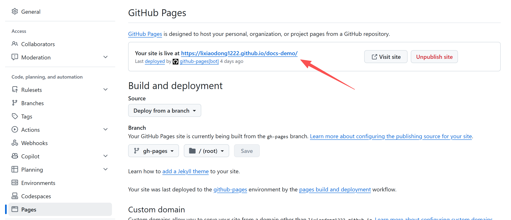
##### 直接点击打开显示错错乱，没有css样式，需要添加.nojekyll这个文件，让github构建时不要使用这个构建工具

.vitepress中新建一个同名的空文件即可
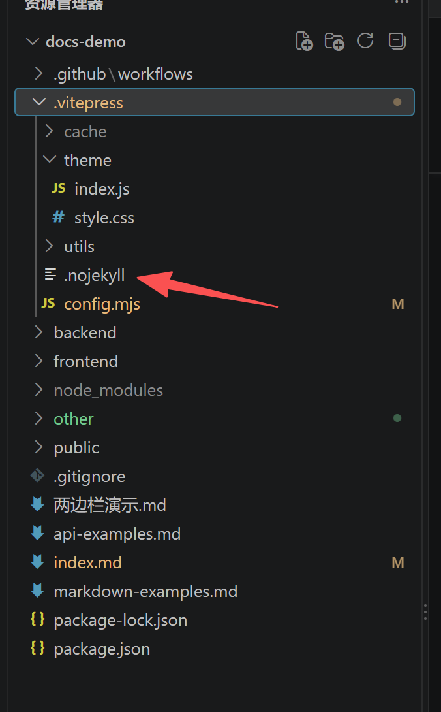
因为访问的地址带docs-demo所以还需要改这两处
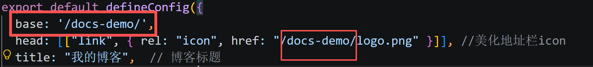

##### 添加自定义域名
下面输入框输入域名 -> 点击save -> 在自己的服务器添加一条记录，填写githug分配好的域名

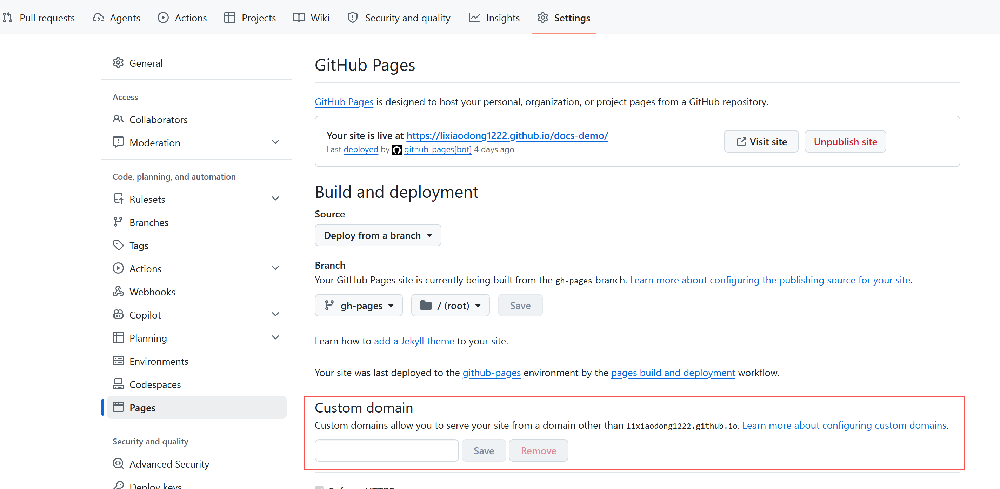
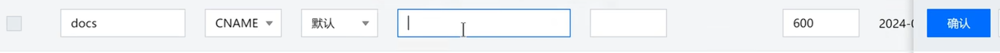

使用域名需要把这行注释掉，不然找不到
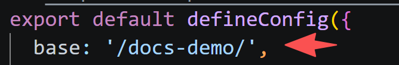

等待分配完成后，需要强制开启HTTPS
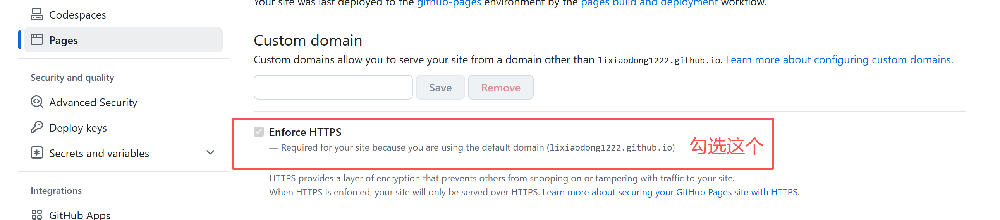